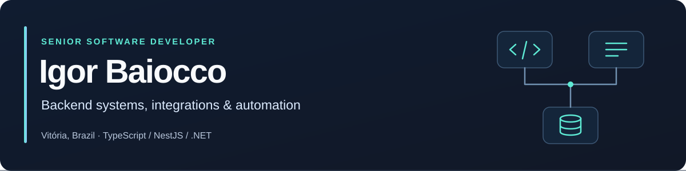

  

I build backend services and integrations with TypeScript, NestJS and .NET. I'm currently a Senior Software Developer at Atman Systems, working on traffic systems. Before that, I spent four years at IndustriALL building industrial software, mobile apps and SAP integrations.

My work spans APIs, business rules, data modeling and the parts of a system that have to agree with each other. I've also worked across React, Angular and React Native, including offline-first mobile applications.

[LinkedIn](https://www.linkedin.com/in/igor-baiocco/) · [Email](mailto:igor64br@gmail.com)

## Tools I work with

  &nbsp;&nbsp;
  &nbsp;&nbsp;
  &nbsp;&nbsp;
  &nbsp;&nbsp;
  &nbsp;&nbsp;
  &nbsp;&nbsp;
  

TypeScript / NestJS · C# / .NET · React / React Native · Angular · SQL · Docker

## Selected projects

### [Even / Tô Quite](https://github.com/igor64BR/even)

An expense-splitting app with a native Android client in Kotlin and a .NET backend. It works offline without an account and uses a balance-graph algorithm to simplify group debts. Optional sync uses SignalR; local data stays in Room/SQLite.

### [Hermes WebUI](https://github.com/igor64BR/hermes-webui)

My fork of [nesquena/hermes-webui](https://github.com/nesquena/hermes-webui), where I'm working on configuration, memory-provider settings and OAuth flows for Hermes Agent. I use agent-assisted development in my own projects, with separate review sessions and explicit checks before publishing changes.

### [Express + TypeScript + Prisma](https://github.com/igor64BR/express-ts-prisma-template)

A backend template for starting Express APIs with TypeScript and Prisma.

## Outside work

I'm studying Information Systems at UFES. My personal projects include household budgeting, developer tools and a self-hosted second brain built around Obsidian and Nextcloud. I also used to teach English.
